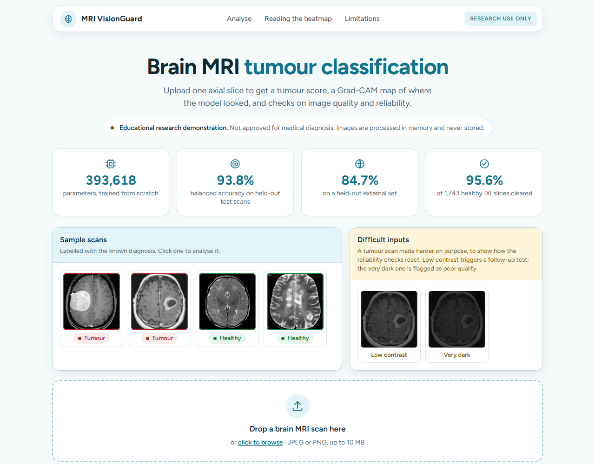
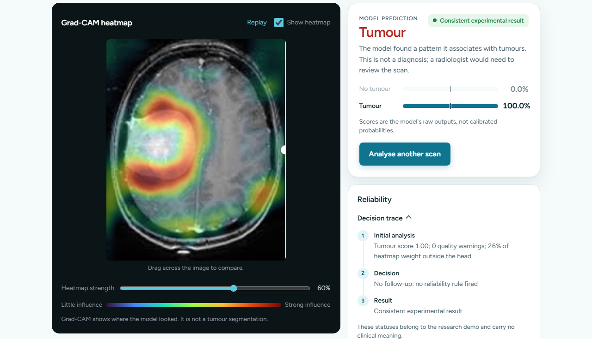
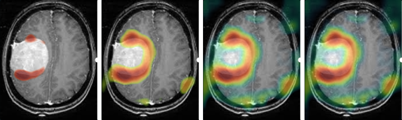

# MRI VisionGuard

A small convolutional neural network that classifies brain MRI slices as tumour or no tumour, wrapped in a web app that shows where the model looked and how far each answer can be trusted.

> **Research and teaching project.** It is not a medical device and must not be used to diagnose or treat anyone.



## What it does

You upload one axial MRI slice (JPEG or PNG). The app then:

1. Checks the image quality with nine OpenCV measurements: sharpness, brightness, saturated pixels, contrast, crop, background, resolution, stray marks and colour.
2. Crops the scan to the head and runs the model, which returns a tumour score between 0 and 1. A score of 0.5 or more counts as tumour.
3. Draws a Grad-CAM heatmap of the regions that pushed the model towards its answer. The heatmap builds up live, strongest region first.
4. Runs a rule-based reliability check. Depending on what the quality checks found, it may re-test the scan once (contrast boost, tighter crop or mirror image) and see whether the answer holds. Each result gets a status (consistent, sensitive, poor quality or needs review) and a step-by-step decision trace.

The reliability check never changes the prediction. It only reports how stable the prediction is.

Under each result, an optional assistant explains it in plain English and answers follow-up questions about it. It uses Claude through the Anthropic API and receives only the numbers (scores, quality checks, reliability status and decision trace), never the image. It is told to explain the app's output and never to give a diagnosis or medical advice.



The heatmap is revealed strongest-first, so the region that drove the prediction appears before the weaker influence around it:



## Results

All figures are from [`docs/evaluation.md`](docs/evaluation.md). The model and its threshold were chosen on the validation split only.

| Test set | Scans | Balanced accuracy | Sensitivity | Specificity | ROC-AUC |
|---|---|---|---|---|---|
| Leak-free test split | 599 | 93.8% | 93.6% | 93.9% | 0.968 |
| Testing benchmark | 1,600 | 90.2% | 92.9% | 87.5% | 0.964 |
| Held-out external set | 253 | 84.7% | 73.5% | 95.9% | 0.942 |

Sensitivity is the share of tumours the model caught. Specificity is the share of healthy scans it correctly cleared.

The external set was kept out of training, but it comes from the same original source as part of the training data, so it is not a test on a different hospital. On it the model misses about one tumour in four, which is the main weakness.

### Healthy scans from a new source

To test on data from a genuinely different source, the model was run on the [IXI dataset](https://brain-development.org/ixi-dataset/) (CC BY-SA 3.0): T1 scans of 581 healthy volunteers from three London hospitals, three axial slices each. None of it was used for training. See [`docs/evaluation.md`](docs/evaluation.md) for how the slices were taken.

- 95.6% of the 1,743 slices were correctly cleared (76 false tumour calls).
- The reliability check sent 46% of the false tumour calls to human review, against 3.4% of the correct answers. A wrong answer was about 13 times more likely to be flagged.

IXI has no tumour scans, so it says nothing about sensitivity on a new source.

## Fixing a shortcut

An earlier version scored well but had learned the wrong thing. In one of the two training sources, tumour images were 512 px and dark while healthy images were about 240 px and brighter, so the model could tell the classes apart from image size and brightness alone. Its heatmaps sat on the skull edge and image border rather than on lesions.

The old "external" set also turned out to be about 97% copies of training images, and near-duplicates across the train and test splits inflated the scores further.

The fixes, all in this repo:

- A leak-free split ([`experiments/leak_free_split/`](experiments/leak_free_split/)) that groups near-duplicate images, keeps each group in one split, and removes every training image that matches a test or external image. The split is checked by [`tests/test_split.py`](tests/test_split.py).
- Preprocessing that removes the source cues: crop to the head, pad to a square, convert to greyscale, normalise brightness per image, then resize to 128×128.
- Training that samples evenly across source and class, so neither source can stand in for the label.

One limit remains: the datasets carry no patient IDs, so slices from the same patient can still end up on both sides of the split.

## The model

| | |
|---|---|
| Architecture | 5 convolution blocks with batch normalisation, global average pooling, linear head |
| Parameters | 393,618, trained from scratch (no pretrained backbone) |
| Input | 128×128 greyscale |
| Weights | [`BrainTumorFinal.pt`](BrainTumorFinal.pt), 1.6 MB |
| Speed on CPU | about 2 ms per prediction, about 16 ms for the full web pipeline |
| Grad-CAM layer | 4th convolution block (a 16×16 map), coloured with the turbo colour map |

## Running it

You need Python 3.13. The app runs on the CPU, so no GPU is required.

```bash
python -m venv .venv
.venv\Scripts\pip install -r webapp/requirements.txt      # Windows
# source .venv/bin/activate && pip install -r webapp/requirements.txt   (macOS/Linux)

.venv\Scripts\python -m uvicorn webapp.app:app
```

Then open http://127.0.0.1:8000 and try one of the sample scans.

To turn on the "Ask about this result" assistant, set an Anthropic API key before starting the server (`set ANTHROPIC_API_KEY=...` on Windows, `export ANTHROPIC_API_KEY=...` elsewhere). Without one, everything else works and the assistant says it isn't set up.

Uploads are limited to JPEG or PNG, 10 MB and 50 megapixels. Images are processed in memory and never written to disk.

A [`Dockerfile`](Dockerfile) is included for packaging, but it has not been built or tested yet.

### Tests

```bash
.venv\Scripts\pip install pytest httpx
.venv\Scripts\python -m pytest
```

The 53 tests cover preprocessing, the quality checks, the reliability rules, the API, the assistant (with a stand-in client, so no API key is needed), the leak-free split and a check that the app, `mainTest.py` and a direct model call give the same answer.

### API

| Method | Path | Returns |
|---|---|---|
| `POST` | `/api/predict` | Prediction, scores, heatmap, quality checks, reliability status and decision trace for an uploaded image (`file` form field) |
| `POST` | `/api/ask` | The assistant's answer, given a result from `/api/predict` and the conversation so far (JSON: `result`, `messages`) |
| `GET` | `/api/model` | Class names, input size, parameter count and the quality and reliability thresholds |
| `GET` | `/api/health` | `{"status": "ok"}` |

## Project layout

```
model.py               Model definitions, preprocessing and loading
gradcam.py             Grad-CAM and heatmap colouring
quality_analysis.py    The nine image quality checks
reliability.py         Follow-up rules, status and decision trace
mainTest.py            Predict on one image from the command line
webapp/                FastAPI app and the static front end (HTML, CSS, JS)
tests/                 pytest suite
docs/                  Evaluation results, IXI results, app flow, screenshots
experiments/           Investigation, leak-free split, training and evaluation scripts
models/                Training run summaries (thresholds and validation scores)
```

The training data is not in the repo. It came from two public Kaggle brain MRI collections plus IXI, and goes in `datasets/` (ignored by git). The trainer is [`experiments/engineer/train.py`](experiments/engineer/train.py); `mainTrain.py` is the original training script, kept so the earlier investigation can be reproduced.

## Limitations

- Trained on a few thousand public MRI slices, without patient information or clinical validation.
- It does worse on scans from sources it was not trained on, and it misses some tumours. A "No tumour" result never rules one out.
- Scores are raw model outputs, not calibrated probabilities. A 99% score does not mean a 99% chance.
- It gives an answer for any image, including ones that are not brain MRIs.
- The Grad-CAM map is coarse. It shows where the model looked, not an outline of the tumour.

## Built with

PyTorch, OpenCV, NumPy, FastAPI and Uvicorn, with a plain HTML, CSS and JavaScript front end (no build step). The optional assistant uses the Anthropic Python SDK.
